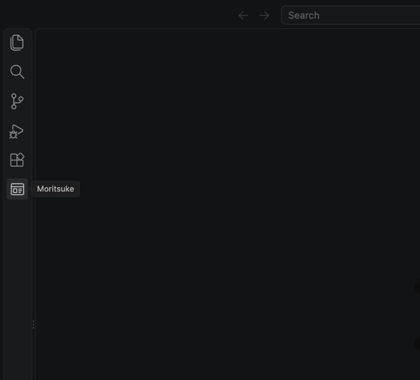
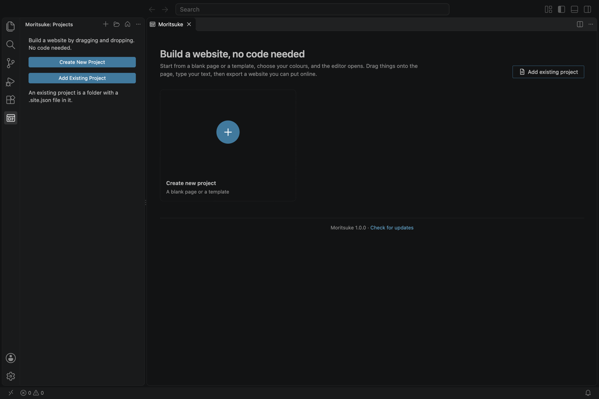
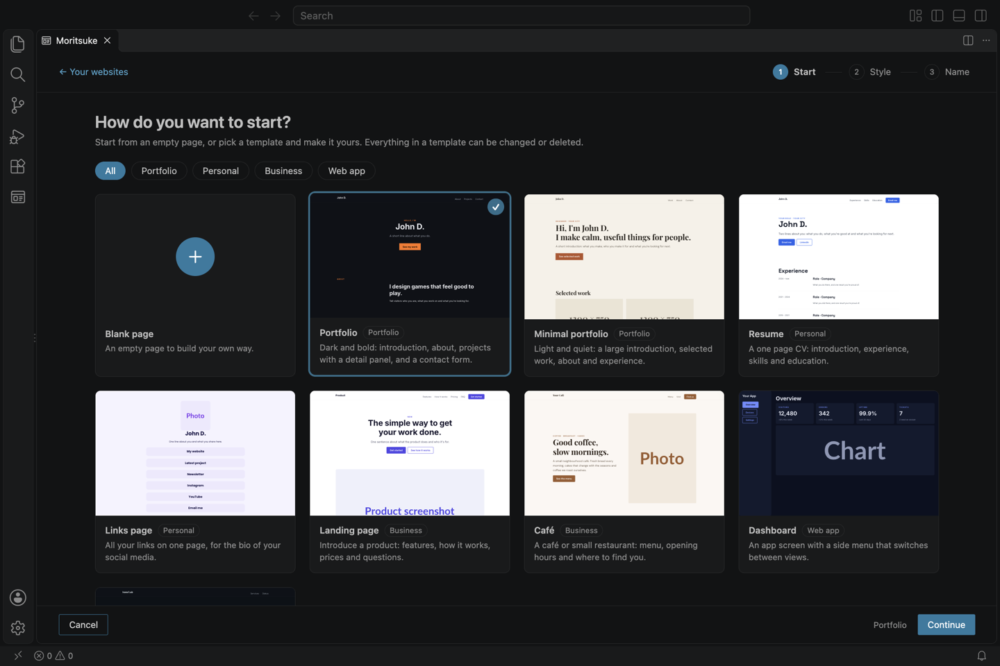
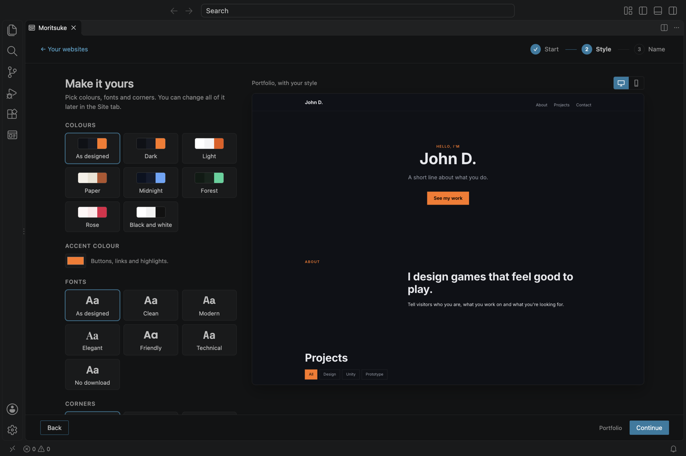
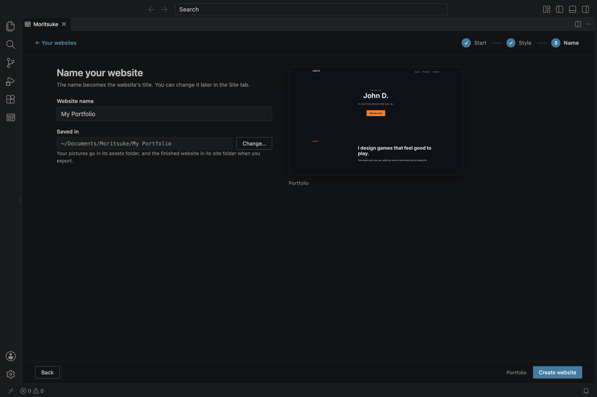
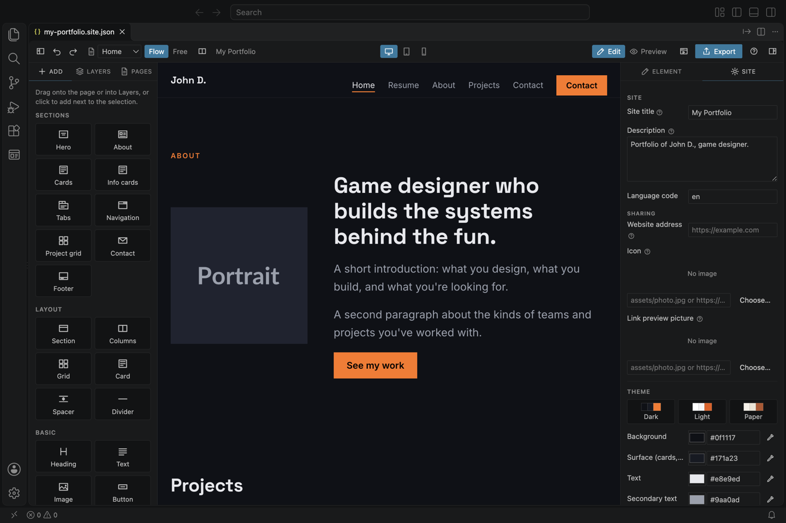
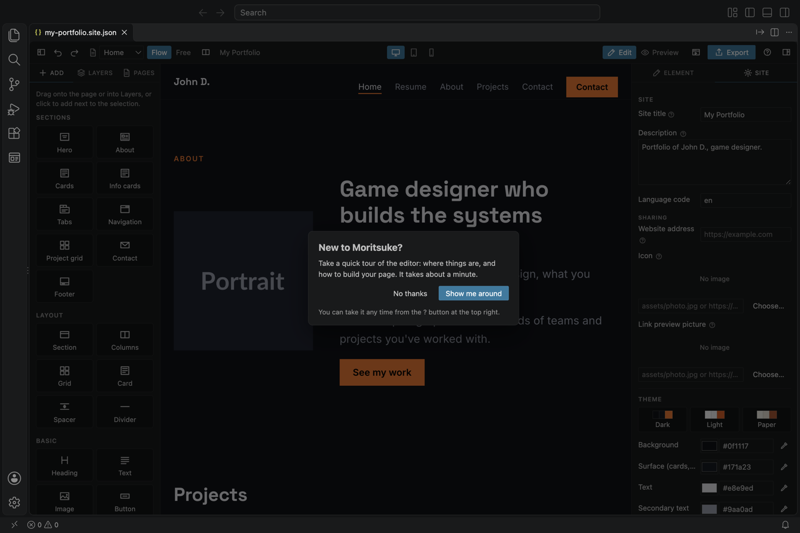
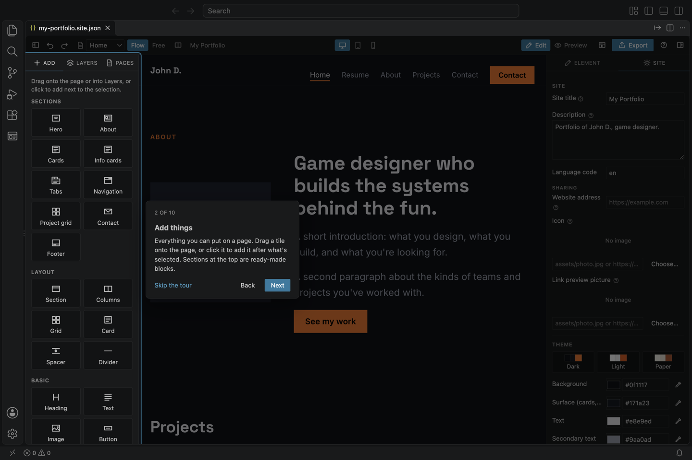
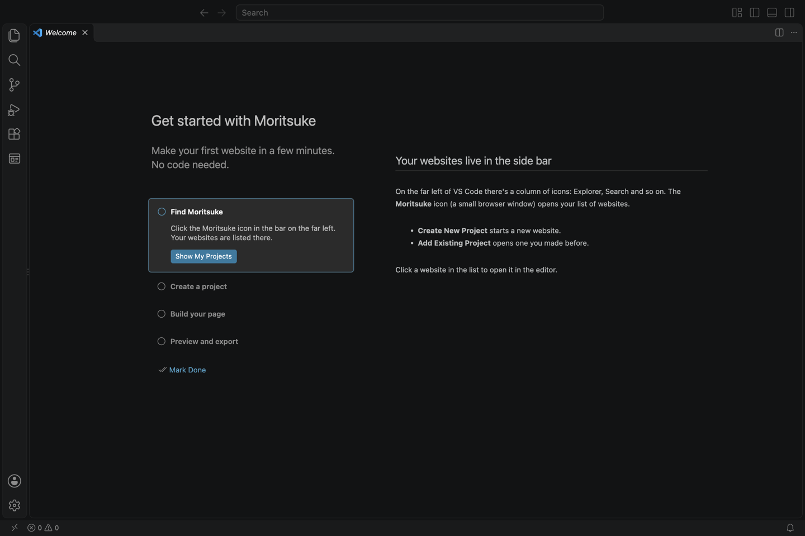

# 1. Getting started

This chapter takes you from installing Moritsuke to having your first website open in the editor. It takes about five minutes.

## Install Moritsuke

Moritsuke is an extension for [Visual Studio Code](https://code.visualstudio.com) (VS Code), a free program for Mac, Windows and Linux. Install VS Code first if you don't have it.

**From a `.vsix` file** (for example, downloaded from a website):

1. Open VS Code.
2. Open the **Extensions** view: click the icon with four squares in the bar on the far left (or press Cmd+Shift+X on a Mac, Ctrl+Shift+X on Windows).
3. Click the **⋯** menu at the top of the Extensions view and choose **Install from VSIX…**
4. Pick the `moritsuke-….vsix` file.

You can also drag the `.vsix` file onto the Extensions view.

## Find Moritsuke

After installing, a new icon appears in the bar on the far left of VS Code, below the Extensions icon. It looks like a small browser window. Point at it to see its name.

Click it. Two things open:

- On the left, the **Projects** list. It's empty for now, so it shows two buttons.
- In the middle, the **Moritsuke** tab. Your websites will show up here as cards, next to a **Create new project** card.

- **Create new project** starts a brand new website.
- **Add existing project** (top right of the tab) opens a website you made before (see [Managing your projects](12-projects.md)).

## Create your first website

Click **Create new project**. Three short steps follow, right in the Moritsuke tab. **Back** at the bottom goes to the step before, and nothing is created until the last one.

**1. Start.** Choose how to start:

- **Blank page** (always first): an empty page to build from scratch.
- A **template**, a finished-looking website you fill in with your own words and pictures. The buttons at the top show one kind at a time:
  - **Portfolio**: *Portfolio* (dark, with an introduction, about, a project grid and a contact form) and *Minimal portfolio* (light and quiet, with selected work and experience).
  - **Personal**: *Resume* (a one page CV) and *Links page* (all your links on one page, for the bio of your social media).
  - **Business**: *Landing page* (introduce a product: features, how it works, prices and questions) and *Café* (a menu, opening hours and where to find you).
  - **Web app**: *Dashboard* (an app screen with a side menu that switches between views) and *Homelab panel* (links to the services on your home server).

Each card shows a small picture of the template. Click one to choose it (double-click to go straight on), then **Continue**.

**2. Style.** Make it yours: pick **colours**, an **accent colour** (for buttons, links and highlights), **fonts** and **corners**. *As designed* keeps what the template has. The picture on the right shows the result as you choose, on a computer or a phone, and you can scroll through it. Everything here can be changed later in the **Site** tab.

**3. Name.** Type the name of your website, for example *My Portfolio*. It becomes the website's title. **Saved in** shows where it goes: a folder with that name in the **Moritsuke** folder of your Documents. **Change…** picks another place.

Click **Create website**. Your website opens in the editor:

The first time you open the editor, it offers a **quick tour**:

Click **Show me around** to take it, or **No thanks**. The tour points at each part of the editor and says what it's for; **Next** and **Back** move through it, and **Skip the tour** (or Esc) ends it.

You can take it any time from the **?** button at the top right of the editor, which also opens this guide.

> **Tip:** to give the editor more room, hide the Projects list on the left with **Cmd+B** (Mac) or **Ctrl+B** (Windows). Press it again to bring the list back.

## Save your work

Moritsuke saves like any other file in VS Code:

- A **dot** on the tab (next to the file name) means there are unsaved changes.
- Press **Cmd+S** (Mac) or **Ctrl+S** (Windows) to save.
- **Undo** with Cmd+Z / Ctrl+Z, **redo** with Cmd+Shift+Z / Ctrl+Y.

## The built-in guide

VS Code also has a short **Get started with Moritsuke** guide with the same first steps. To open it: press Cmd+Shift+P / Ctrl+Shift+P, type **Open Walkthrough**, and choose **Get started with Moritsuke**.

---

Next: [The editor](02-the-editor.md)
