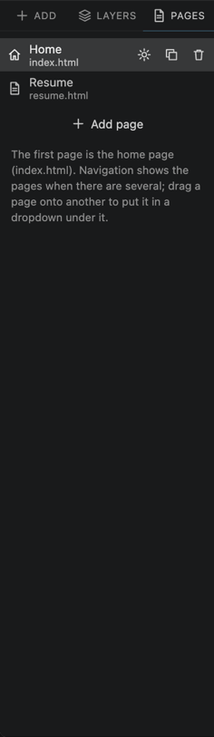
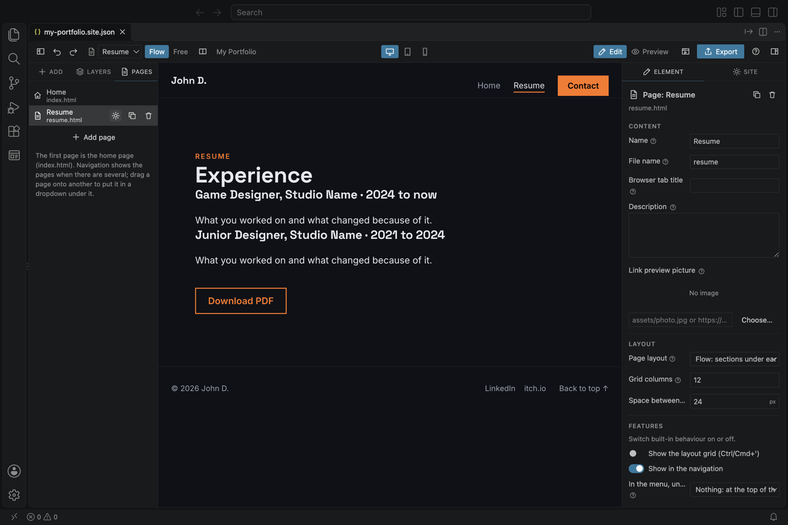
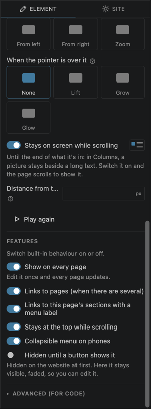

# 6. Pages

A website can have several pages, like **Home**, **Resume** and **Blog**.

## The Pages panel

Open the **Pages** tab on the left.

- **Click** a page to show it on the canvas.
- **Drag** a page up or down to change the order. The order is also the order of the links in the navigation bar.
- **Drag a page onto another page** to put it in a **dropdown** under that page in the menu (see [Dropdown menus](#dropdown-menus) below).
- **Add page** creates a new empty page and opens its settings.
- The buttons on a page (shown when you point at it) open its **settings**, **duplicate** it, or **delete** it. You can't delete the last page, and the Delete key never deletes a page, so you can't remove one by accident. Deleted a page by mistake? Press **Undo**.

The **first page is your home page**: the page visitors see first (`index.html`).

You can also switch pages with the **page menu** in the toolbar.

## Page settings

Click the settings button on a page (or select it in Layers) to see its settings:

- **Name**: shown in the navigation bar.
- **File name**: the page's address, for example `resume` becomes `resume.html`. The first page is always `index.html`.
- **Browser tab title**: the text in the browser tab. Leave it empty to use the page name and the site title.
- **Description**: shown by search engines. Leave it empty to use the site description.
- **Link preview picture**: the picture shown when someone posts a link to this page. Leave it empty to use the site's picture (see [Sharing](07-site-and-theme.md#sharing)).
- **Show in the navigation**: turn off for pages that shouldn't be in the menu (for example a thank-you page).
- **In the menu, under**: the page this one drops down under in the menu, or *Nothing* to keep it at the top.
- **Page for broken links**: makes this the page visitors see when they follow a link to a page that doesn't exist (see [A page for broken links](#a-page-for-broken-links)).
- **Page layout**: *Flow* (the usual way: sections under each other) or *Free*, described next. The same switch is in the toolbar.

## Free layout: place things anywhere

At the top of the editor, next to the page menu, **Flow | Free** switches the page you're on:

- **Flow** is the usual website page: sections sit under each other and adapt to any screen. Its grid button shows a **column guide**: columns (12 unless you change the number beside it) across the content width, so you can see whether headings, text and cards line up. It's only there while you edit.
- **Free** turns the page into one screen of a fixed size, like a frame in a design tool. Instead of stacking, you put each element exactly where you want it.

Good for a dashboard, a control panel, a menu screen, or anything that behaves more like an app than a page to read.

Switching a page that already has content keeps it: its sections are placed top to bottom where they were. Switching back to **Flow** puts everything under each other again and remembers where things were, so you can go back and forth.

On a free page the toolbar also shows:

- the **screen size** (Desktop, Laptop, Tablet or Phone; any other size can be typed in the page's settings). Elements that ran the full width of the screen stay full width when the size changes;
- the **grid button**, which shows a grid of thin lines to line things up by, with its **size** beside it. It's only there while you edit, never on the website, and elements snap to it while it's showing. **Cmd+'** (**Ctrl+'** on Windows) shows and hides it.

Too distracting? The small colour square next to the grid controls sets the grid's **colour** and **strength**, for both kinds of grid. That's your own preference in the editor, not part of the project, and **Reset** brings back the default grey.

How it works:

- The screen's edge is drawn with a dashed line, and its size is written above it, so you can see where the page ends. When the screen is wider than the editor, it's shown smaller so all of it fits ("shown at 68%"); everything you place still lands at its real size.
- Drag anything from the **Add** panel onto the screen and it lands centred on the pointer, where you drop it.
- Drag an element to move it. Pink lines appear when it lines up with another element or with the middle or edges of the screen, and it snaps into place: edges line up with edges (or sit right against them), and middles with middles. Hold **Alt** while dragging to ignore the snapping.
- **Even spacing.** When elements sit in a row (or a column) with gaps between them, moving another one into that row snaps it to the same gap: after the last one, before the first, or exactly in the middle between two. The matching gaps light up with their size, so a row stays tidy without grouping anything.
- The first click on a card (or anything with elements inside) picks the whole card. Click again to reach what's inside it.
- **Resize** by dragging the small white squares around the selected element. Each element fills its box, so a picture, button or card takes exactly the size you drag it to. The sides change one direction at a time; the corners change both. Hold **Shift** on a corner to keep the proportions. The edge you drag snaps to other elements' edges and the screen's edges, while the opposite edge stays put. Headings and text keep growing with their words unless you drag their height yourself.
- **Arrow keys** move the selection one pixel at a time, or ten with **Shift** held.
- Select several elements (Shift-click) and drag any of them: they all move together, keeping their arrangement. With several selected, the right panel also has buttons to **line them up** (left, middle, right, top, middle, bottom) or **spread them out evenly**.
- When elements overlap, the arrows in the selection bar **bring one forward** or **send it backward**. In the **Layers** panel, the higher an element is in the list, the more in front it is, the same as in design tools. New elements go in front.
- The right panel shows **From the left**, **From the top**, **Width** and **Height** for exact numbers. A height of 0 means "as tall as the content".
### On other screen sizes: Scale or Adapt

A free page is designed at one size. What happens in a window of another size is set in the page settings, **On other screen sizes**:

- **Scale** (the default): the whole screen shrinks or grows to fit, keeping your layout exactly as you designed it, only smaller on a phone.
- **Adapt**: the screen fills the window, and each element keeps the edges it's **anchored** to. A menu anchored to the left and top stays in the top left corner; a panel anchored left and right stretches with the window. When you switch Adapt on, every element gets a first guess from where it sits, and the selected element shows its anchors in the right panel. Change the screen size in the toolbar to see what a bigger or smaller window will do.

Other pages of the same website stay flowing, so a site can have ordinary pages and app-like screens side by side.

## Free sections: place things anywhere on a normal page

You don't need a whole free page to overlap a picture and a heading. Select a **Section** and set its **Layout** to **Free** in the right panel. The section becomes an area of its own height where elements are placed, snapped, resized and anchored exactly like on a free page, while the rest of the page keeps flowing above and below it.

- Drag the handle under the area to change its **height**.
- **Scale** or **Adapt** works the same as for a free page.
- Switching back to **Flow** stacks the elements again and remembers where they were, for next time.
- Elements inside a free section can't be dragged out of it on the page; use **Layers** for that.

## A menu and footer on every page

Usually every page should have the same navigation bar and footer. Select the navigation bar (or footer) and turn on **Show on every page** in its **Features**:

Now it appears on all pages, and changing it once changes it everywhere. In **Layers** it moves to the **Every page** group. You can also drag a navigation bar or footer into **Every page** in Layers.

Turning **Show on every page** off keeps it only on the page you're looking at.

## Dropdown menus

A page can sit in a **dropdown** under another page in the menu, like *Work* with *Project One* and *Project Two* under it.

1. In the **Pages** panel, drag a page **onto** another page. The page under the pointer gets an outline, and the label next to the pointer says where it will go ("Project One → under Work").
2. Let go. The page moves under that page and is shown indented.

On the website, the page with pages under it gets a small arrow in the menu, and its pages drop down when a visitor points at it (or reaches it with the Tab key). In the menu on phones, they're listed under it.

To bring a page back to the top, drag it **between** two pages that aren't in a dropdown. A dropdown is one level deep, and the home page always stays at the top. The same choice is in the page settings: **In the menu, under**.

## A page for broken links

When a visitor follows a link to a page that doesn't exist (an old link, a typo), web hosts show a page called `404.html`. Moritsuke makes one for you: your menu and footer, a short "This page isn't here", and a button back to the home page.

To design your own, add a page and switch on **Page for broken links** in its settings. It becomes `404.html`, it's left out of the menu, and search engines are asked not to list it.

## Links between pages

- With more than one page, the navigation bar links to every page (unless you turn **Links to pages** off, or turn off **Show in the navigation** for a page). The current page is underlined.
- Links to the **sections** of a page (from their **Menu label**) only appear on that page.
- To link to a page from a **Button**, use its file name, like `resume.html`. To link to a section on another page, add the section after a `#`, like `index.html#contact`.

Try links in **Preview**: clicking a link to another page switches to it.

---

Next: [Colours, fonts and site details](07-site-and-theme.md)
