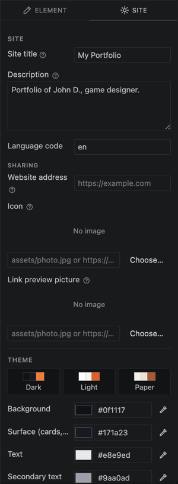
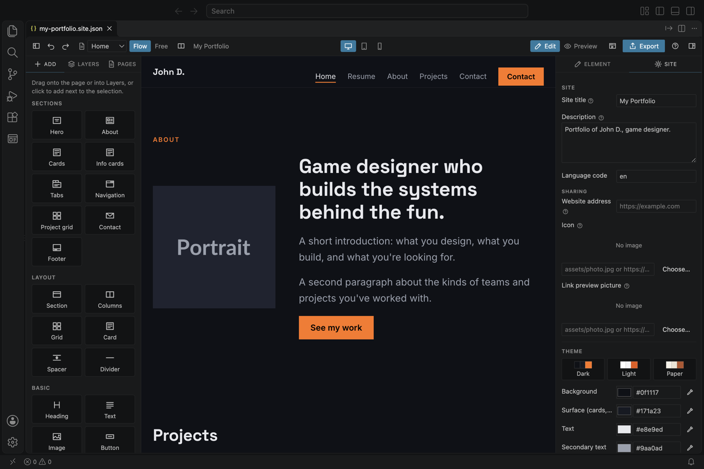
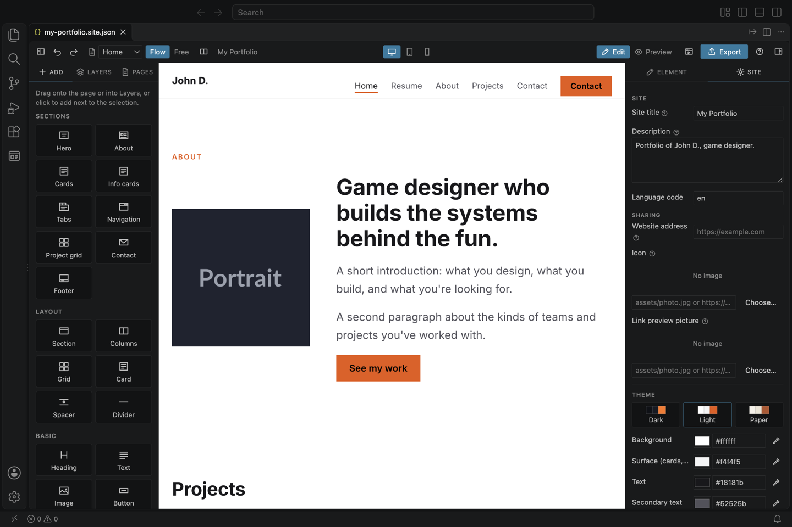
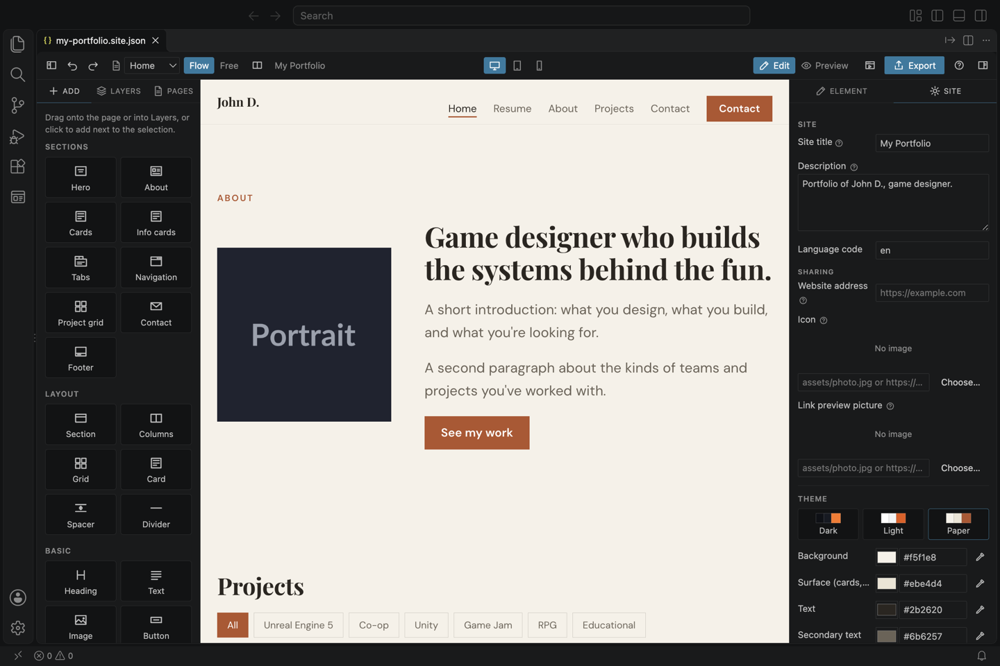

# 7. Colours, fonts and site details

The **Site** tab on the right holds the settings for your whole website.

## Site details

- **Site title**: shown in the browser tab and in search results.
- **Description**: one or two sentences that search engines and link previews show.
- **Language code**: the language of your website, for example `en` for English or `fr` for French.

## Sharing

- **Website address**: where your website will live once it's online, like `https://example.com`. You can leave it empty until you know it. Link previews need it to show a picture from your project, and with it every export also gets `sitemap.xml` and `robots.txt`, which help search engines find all your pages.
- **Icon**: the small picture in the browser tab and in bookmarks. A square PNG or SVG works best, at least 180 × 180 pixels.
- **Link preview picture**: the picture shown, with your title and description, when someone posts a link to your website in a chat app or on social media. 1200 × 630 pixels fits most places. A page can have its own in its page settings.

Safari keeps tab icons for a long time: if you change the icon and Safari still shows the old one (or none), try another browser to check it.

## Theme

**Presets** change all colours at once (and, for Paper, the fonts too). Start with a preset, then adjust.

| Dark | Light | Paper |
| --- | --- | --- |
|  |  |  |

**Colours:**

- **Background**: the page.
- **Surface**: cards, the contact section and panels.
- **Text** and **Secondary text** (softer text, like descriptions).
- **Accent**: buttons, labels, links and highlights. The text on accent-coloured buttons turns black or white automatically, whichever is easier to read.

Click the coloured square to pick a colour, or type a colour code like `#FF7518`.

**Fonts:** a **Heading font** and a **Body font**. *System font* uses the visitor's own computer font and loads instantly. The others come from Google Fonts.

**Corner radius:** `0` for square corners, higher for rounder buttons, cards and pictures.

**Content width:** how wide the content of sections gets on big screens.

**More:** the colour of **links in text** (empty uses the accent), **heading size** and **text size**, **section spacing** (the space above and below every section), the **button shape** (like the corners, square, rounded or pill), and **smooth scrolling**, which makes menu links and *Back to top* glide to their place instead of jumping.

## Export folder

The name of the folder your website is exported to (`site` by default). See [Exporting](11-export.md).

## Code (optional)

At the bottom, for people who write code: `custom.css` and `custom.js`, and two boxes for code that goes **in the head** or **at the end of every page** (an analytics snippet, for example). See [For people who write code](13-for-developers.md).

---

Next: [Design: backgrounds, the Look box and effects](08-design.md)
