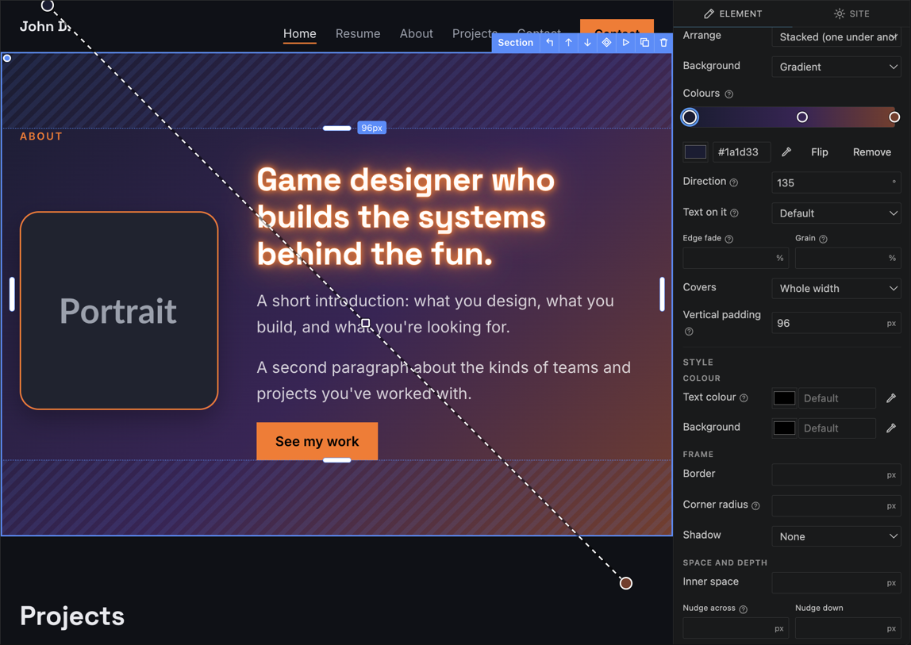
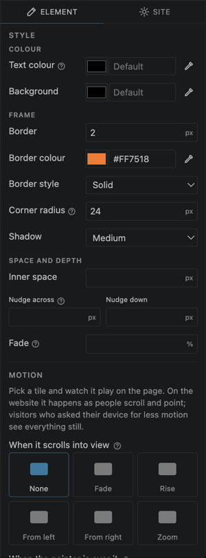
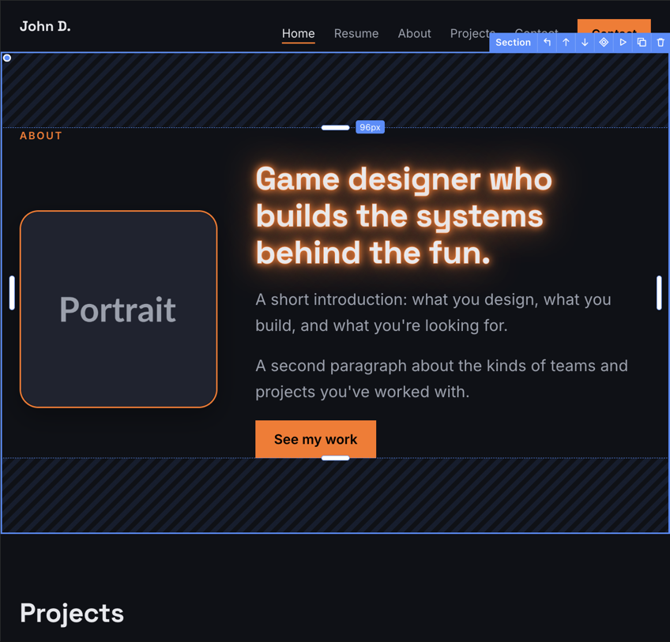

# 8. Design: backgrounds, the Look box and effects

Chapter 7 sets the look of the whole website. This chapter is about giving a single section or element a look of its own. Everything here is optional: an element you haven't touched looks the way the theme says.

## Section backgrounds

Select a **Section** and open **Background** in its **Layout** settings:

- **Page**, **Surface** and **Accent** use the theme's colours.
- **Custom colour**: any colour you pick.
- **Gradient**: up to nine colours blending into each other. With the section selected, a **line with a dot at each end** appears on the page: drag the ends to change the direction and where the gradient starts and finishes. The small markers on the line are the colours in between; drag them along the line. The colours themselves are in the panel, under **Colours**.
- **Picture**: a picture behind the section's content.
  - **Fit**: *Fill* covers the whole section (and may crop the picture), *Fit inside* shows all of it, *Tile* repeats it.
  - **Picture position**: which part stays in view when it's cropped. *Where you dragged it* is set by the round **grip** on the page: drag it to move the picture inside the section.
  - **Darken** and **Blur** make text on top easier to read; **Text on it** switches the text to light or dark for a dark or light picture.
  - **Edge fade** fades the picture out towards the edges, and **Grain** adds a little film grain.
- **Covers**: the **Whole width** of the window, or only the **Content column**.

## The Look box

Every element has a **Style** group with the same settings, called the Look box:

- **Colour:** the **text colour** and a **background**.
- **Frame:** a **border** (its colour and style: solid, dashed or dotted), the **corner radius** and a **shadow** (soft, medium or strong, or inside the element).
- **Space and depth:** **inner space** (padding), a **nudge** across and down, and a **fade**.

A **nudge** moves the element a little from where it would be, without changing the layout around it. It's the simple way to let a picture overlap the section above, or a label hang over a card's edge. For full freedom, use a [free section](06-pages.md#free-sections-place-things-anywhere-on-a-normal-page).

The corners also have a handle on the page: with the element selected, a small round dot sits inside its top left corner. Drag it towards the middle for rounder corners.

## Effects on text

Headings, text and buttons have **effects** under the Look box. Each one is a switch with its own settings, and several can be on at once:

- **Outline**: a line around the letters, with its **thickness** and **colour**. **Hollow** leaves nothing inside the letters, only the outline.
- **Glow**: a soft light around the letters, with its **size**, **strength** and **colour**.
- **Shadow**: a shadow at a **distance** and **direction** you choose, with its own **blur** and **colour**.
- **Gradient fill**: the letters filled with a gradient of your colours, in a **direction**.
- **Blur**: *Soft* blurs all round; *Motion* smears in one **direction**, as if the words were moving fast.

A blur can also be kept to **patches**: add **Blur areas** (a box or an oval), then move and resize each one on the page. A patch either blurs *this element only*, or *everything behind it*, like frosted glass.

## Handles on the page

Some settings have a handle right on the page, so you can drag the thing itself instead of typing numbers. The numbers stay in the panel for when you want them exact.

- **A section's spacing:** select a section and drag the **dashed line** at its top or bottom. The striped band is the space you're changing (above and below stay equal). It moves in steps of 8; hold **Alt** for any value.
- **A section's width:** drag the **bar** on its left or right side. It catches at the theme's width, the narrow width and the full window; anywhere else becomes the section's own width.
- **A cropped picture:** drag the round **grip** to choose which part of the picture shows.
- **A colour from the page:** every colour setting has a **dropper**. Press it, then click anything on the page to take its colour: a pixel of a picture, a letter, a background or a point of a gradient. **Esc** calls it off.

---

Next: [Motion](09-motion.md)
