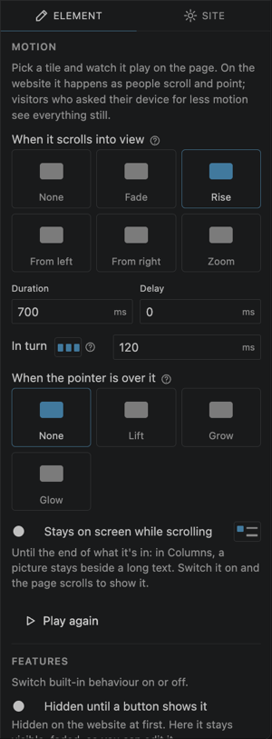

# 9. Motion

Every element has a **Motion** group in its settings. Each choice is a small tile that acts out what it does, and picking one plays it on the page straight away.

## When it scrolls into view

How the element arrives the first time a visitor scrolls to it: **Fade**, **Rise**, **From left**, **From right** or **Zoom**. **Duration** is how long it takes, **Delay** how long it waits first.

On a section, card, grid or columns, **In turn** brings what's inside in one after another instead of all at once, this many milliseconds apart. A row of cards then arrives card by card.

## When the pointer is over it

**Lift** (up, with a shadow), **Grow** (a little bigger) or **Glow** (a light in the accent colour). Good for cards and buttons.

## Stays on screen while scrolling

The element stays in view while the rest scrolls, until the end of what it's in. In **Columns**, a picture next to a long text stays beside the text as the visitor reads. **Distance from the top** leaves room for a navigation bar that stays at the top too.

It only stays while what it's in is taller than it is: next to a long text, not on its own.

## Its effects, while scrolling

For text with [effects](08-design.md#effects-on-text): **Clear up** makes them fade away as the element comes up the screen (a blur that clears), **Build up** makes them grow (a glow that builds).

## Seeing it

- While you edit, nothing hides itself and nothing moves under your pointer, so editing stays calm. Motion plays when you pick a setting, when you press the **play** button in the element's bar on the page, or **Play again** in the panel.
- In **Preview** and on the website it happens for real: scroll down and point at things.
- Visitors who have asked their device for less motion see everything in place, without movement.

**Smooth scrolling** for menu links and *Back to top* is in the **Site** tab (see [Colours, fonts and site details](07-site-and-theme.md)).

---

Next: [Screen sizes and Preview](10-preview-and-screen-sizes.md)
